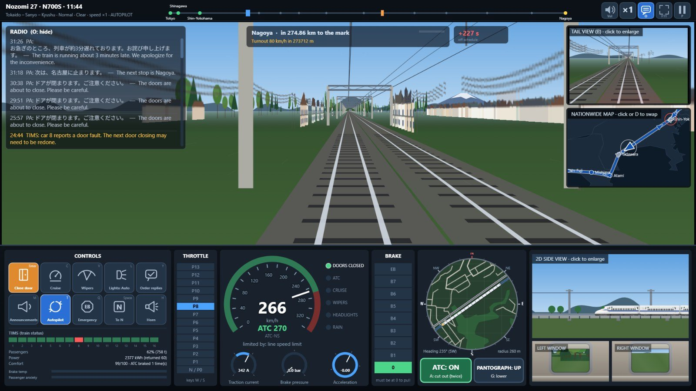
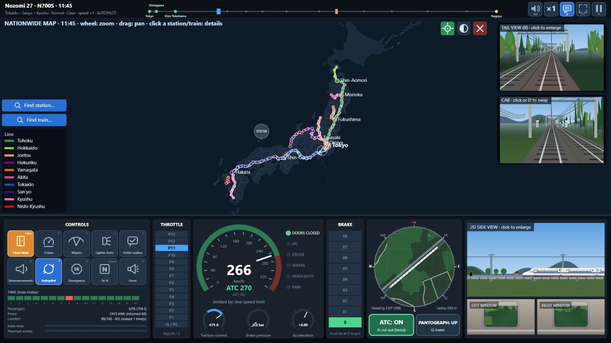
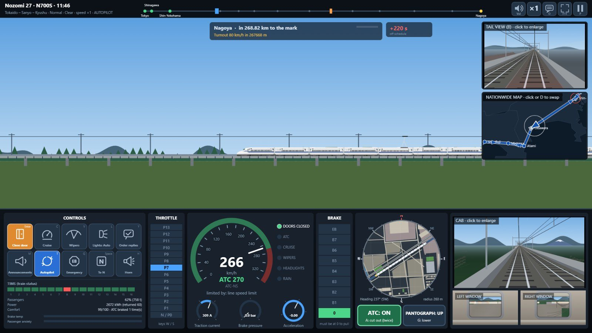
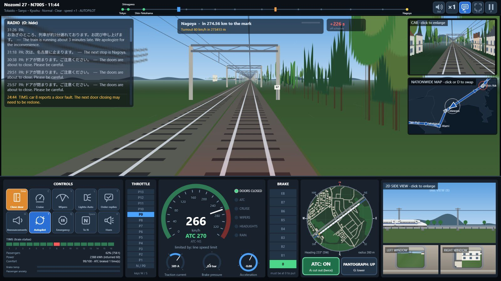
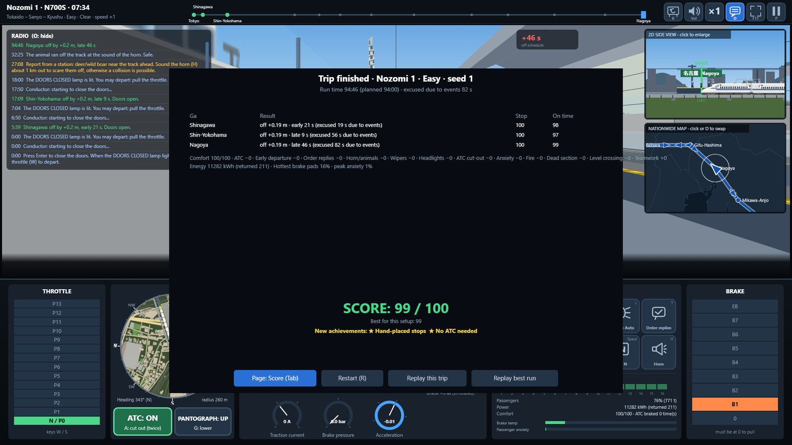

<div align="center">


# Drive Shinkansen · 新幹線を運転 · Lái Shinkansen

[Tiếng Việt](README.md) · **English** · [日本語](README.ja.md)

A Shinkansen driving game covering the five JR companies that run it, playable entirely in the browser (HTML/JS, nothing to install).



</div>

A hobby project, **unofficial and not affiliated with JR or any company mentioned**. Names, train types and station names are real names used only for simulation.

**Play:** the GitHub Pages site of this repository (see *Settings → Pages*), or run it locally (see *Run locally*). The interface is available in **English, 日本語 and Tiếng Việt** (choose it in Settings; the default follows your browser language).

## Features
- **7 lines, 5 JR companies:** Tokaido–Sanyo–Kyushu, Tohoku–Hokkaido, Joetsu, Hokuriku, Nishi-Kyushu, plus the Yamagata and Akita mini-Shinkansen lines (including coupling and uncoupling at Tokyo, Fukushima and Morioka). **Real October 2026 timetables**, with train types from the N700/N700S, E5, E6, E7/W7, E8, H5, 800 and N700S-8000 to the 923 Doctor Yellow and E926 East i inspection trains.
- **Realistic driving:** 13 power notches, 8 brake steps, ATC, cruise control, pantograph, wipers, headlights, frequency-change dead sections, passing loops and through tracks at stations, turnouts into the platforms, and trains ahead or passing through on the real timetable. On the single-track Akita/Yamagata lines your train stops to let oncoming trains pass (even at stations with no scheduled stop); a mini-Shinkansen waits for the Tohoku train to reach the station before coupling and never enters the junction area before it.
- **A world that runs on the real timetable:** oncoming trains, trains standing at stations, trains passing through and the train ahead are all real trains from the timetable, shown exactly where the nationwide map puts them; held trains (earthquake, rain or wind, incident) stand completely still. Random incidents happen to **every train**, not just yours.
- **Weather and random incidents (seeded):** rain (drops collect on the front and rear glass and the wipers clear them), snow, typhoon, earthquakes, fire in a tunnel, ill passengers, animals, a vehicle stuck on a level crossing (only on Yamagata and Akita, the only lines with level crossings), dispatcher orders you must repeat back, extra stops to let a fast train overtake. 4 difficulty levels.
- **Free mode:** adds an autopilot button and does not score the trip; on the nationwide map click a train and choose "Enter cab" to look into its cab (the Doctor Yellow and East i inspection trains too).
- **Many viewpoints:** a pseudo-3D cab, a 2D side view, a top-down minimap (north up), left and right passenger windows, and a rear-of-train camera.
- **Scenery:** built from OpenStreetMap data; train fronts and tails follow the real nose profile; many kinds of overhead-wire supports (steel portals, steel-pipe beams, かご beams, side poles with swing brackets, tunnel-ceiling hangers), never with a pole between two tracks.
- **Nationwide map** ([screenshot](#screenshots)): 47 prefectures with **every island in the data** (including the Northern Territories, drawn dashed), 10 line segments in Wikipedia colours, **every train running on the real timetable** plus weather and earthquakes; click a station or train for details, including the trains ahead and behind and their gaps.
- **On-board announcements** spoken in Japanese, with subtitles (the Japanese interface shows a single subtitle line): next stop, connecting lines, which side the doors open, delays, incidents. The door side matches the platform track the train is routed to, even at stations with many tracks.
- **Tutorial:** 4 step-by-step lessons (driving and stopping, equipment, incidents, pantograph and ATC). **Profile:** 14 achievements, best results, history and replays of past trips.
- **Sound:** running noise, wind, rain, horn, station ambience; airliner cabin hum (J); a **music player** in the menu with 21 Shinkansen station melodies.
- **Multilingual:** English, 日本語 (station names in kanji, train names like のぞみ1号), Tiếng Việt.
- Domain research notes are in [`docs/`](docs/00-progress.md) (Vietnamese), the simulation architecture in [`docs/14-kien-truc-mo-phong.md`](docs/14-kien-truc-mo-phong.md), game design in [`docs/10-thiet-ke-game.md`](docs/10-thiet-ke-game.md).

## Screenshots
| | |
|---|---|
| <br>Nationwide map: every train on the real timetable | <br>2D side view |
| <br>Rear-of-train camera | <br>Trip summary: score, achievements, advice |

## Menus
- **Home screen:** Drive · Learn to drive · Profile · Settings · Asset credits (plus the logos of the five JR companies, each linking to its official site).
- **Trip setup:** a 2D picture of the selected train's front cars; line, direction, train, from/to stations, difficulty, weather, seed; the same seed gives the same trip. Tohoku trains that have a mini-Shinkansen partner with the same number, time and stops (56 trips: Hayabusa+Komachi, Yamabiko+Tsubasa) **always run coupled** from Tokyo to Morioka/Fukushima, even when random incidents make the schedule flexible.
- **Real-time mode** (the checkbox at the top of the right column): uses **Japan time** (only trains that have not yet left are listed; when none are left only the Doctor Yellow and East i inspection trains remain), **live weather** (rain, snow and wind gusts per hour along the line, from Open-Meteo) and **real earthquakes** (P2PQuake: those from the last few hours cause slow inspection running near the epicentre; one that strikes **while you play** cuts the power if the shaking is strong enough at your train). Difficulty is fixed to Normal. It needs a connection when you press Start (and, for earthquakes, while you play); offline it falls back to random weather. The data is snapshotted at the start and new earthquakes are recorded like your inputs, so replays stay exact.
- **Free mode** (the checkbox next to Real-time mode): adds an autopilot button; the trip is not scored, earns no achievements and is not saved in the history or records. On the nationwide map click a train and choose "Enter cab" to look into its cab (it drives itself and its controls are locked); the "Return to your train" button brings you back. Leave it off for no autopilot and a scored trip.
- **Pause (P or Esc):** Resume · Settings · Profile · Snapshot (F9) · Restart · Back to main menu.
- **Settings:** language, scenery (full/light) and the **complete keyboard shortcut table**. Fast-forward always returns to ×1 on a radio call.
- **Music player** (bottom left, menus only): play/pause, previous/next, one button cycling repeat all / repeat one / shuffle, track list, mute and volume, progress bar, collapsible; it plays through the embedded YouTube player (needs a connection) and starts automatically after your first click or key press.

## Controls
The full table is in **Settings → Shortcuts**.

| Key | Action |
|---|---|
| W / S | raise / lower the power lever (13 notches) |
| ↓ / ↑ | apply / release the brake (release to 0 before power can be applied again) |
| Space · Q | back to N · emergency brake |
| Enter | close the doors; when the lamp lights, pull the lever to depart |
| C · [ ] | cruise control · adjust ∓5 km/h |
| A · G · V · L | ATC (press twice to cut out) · pantograph · wipers · headlights |
| Y / N · M | repeat back an order, accept / decline · reassuring announcement |
| K | (inspection train) mark a defect (measuring starts automatically when the train leaves) |
| Tab · B · O | change view · rear-of-train camera · hide the radio |
| , · . | left · right passenger window (press again to return to the cab) |
| J | airliner cabin hum on/off (speaker button, top right: one click opens the volume slider, a second click mutes) |
| D | swap the nationwide map and the current view (wheel to zoom, drag to pan, click a station or train for details; the locate button returns to your train) |
| H | horn (the game also sounds it automatically for workers, deer, non-stop stations, level crossings and a stopped train ahead) |
| P (or Esc) · F9 · F11 | pause · snapshot (PNG plus a JSON file that rebuilds the scene) · fullscreen |
| 1 2 3 · T · R | fast-forward ×1/×4/×16 (the square ×N button, top right, cycles ×1 → ×4 → ×16) · autopilot · restart |

## Run locally
```
cd prototype/drive
python -m http.server            # then open http://localhost:8000
```
Opening `index.html` directly also works, but the station ambience cannot be seeked and the music player needs an `http://` address.

## Tests and deployment
```
node tests/run.js                # sequential tests as in CI: simulation, map, multilingual checks... (~15 minutes)
node tests/run.js --time         # print the time of each section
node tests/run.js --only=k       # run only section k
node tests/run.js --shard=1/4    # run batch 1 of 4 (split to run in parallel)
node tests/run-parallel.js       # one process per section (~12 minutes); faster but cannot catch order-dependent bugs
node tests/soak.js --lines=aki   # soak test: autopilot whole trips with random incidents and bad weather, checking for trains passing through each other, stalls, exceptions...
```
Run the sequential pass (`tests/run.js`) before pushing, because CI does the same. `tests/soak.js` is not part of CI; a failing trip can be reproduced with `--tag` and `--seed`. GitHub Actions: `ci.yml` runs the tests on every push; `pages.yml` runs the tests and then publishes `prototype/drive` to GitHub Pages. Technical notes (files, i18n, map, music) are in [`prototype/README.md`](prototype/README.md) (Vietnamese); simulation architecture and the reliability of each mechanism are in [`docs/14-kien-truc-mo-phong.md`](docs/14-kien-truc-mo-phong.md) and [`docs/15-do-tin-cay-co-che-moi.md`](docs/15-do-tin-cay-co-che-moi.md) (Vietnamese).

## Credits and asset licences
| Component | Author / source | Licence |
|---|---|---|
| Browser tab icon (`prototype/drive/assets/logo.png`) | 西日本旅客鉄道 (JR West), [File:Shinkansen-W.png](https://commons.wikimedia.org/wiki/File:Shinkansen-W.png), Wikimedia Commons | CC BY-SA 4.0 |
| JR Hokkaido / East / Central / West / Kyushu logos on the home screen (`jr_*.png`) | The respective JR companies | Trademarks of each company; illustration only, each links to the official site |
| 2D train images (N700, N700S, E5, E6, E7/W7, E8, H5, 800, N700S-8000, 923, E926, E2, 500, E3, E4) and front views cut from them | Nanyue Express / K.Y. Chung — [rail.kychung.com](https://rail.kychung.com/) | CC BY-NC-ND 4.0. The car strips in `prototype/drive/assets/*_strip.*` and the trip-setup previews `pv_*.png` are cut-and-assembled from the originals; **non-commercial use only**, the owner may ask for removal. See `prototype/drive/assets/NGUON.md`. |
| Maps, buildings, roads, parks, trees; coastlines of the Northern Territories | © OpenStreetMap contributors — [openstreetmap.org/copyright](https://www.openstreetmap.org/copyright), data from [Geofabrik](https://download.geofabrik.de/) and the Overpass API | ODbL 1.0. The compiled data in `prototype/drive/world/` and `japanmap_nt.js` is a derived database, also under ODbL. |
| 47 prefecture boundaries (nationwide map, `japanmap.js`) | [geoBoundaries](https://www.geoboundaries.org) gbOpen JPN ADM1 (2017) | ODbL 1.0 |
| Station ambience and passing trains | Flavien Gillié, "Odawara Station, Préfecture de Kanagawa, Japon – Shinkansen train leaving for Tokyo", Internet Archive `aporee_70029_81567` | Public Domain Mark 1.0 |
| Shinkansen station melodies (music player) | YouTube video [`bddFo2Vzi4A`](https://www.youtube.com/watch?v=bddFo2Vzi4A), played through the official embedded player, no file saved | Owned by the video owner and JR; subject to the YouTube terms |
| Track and platform layout of each station | Japanese Wikipedia (the station articles) | CC BY-SA 4.0 |
| Live weather (real-time mode) | [Open-Meteo.com](https://open-meteo.com/), hourly forecast; requested from the browser when you press Start and kept only as the trip's snapshot | CC BY 4.0 (data), non-commercial use |
| Real earthquakes (real-time mode) | [P2PQuake](https://www.p2pquake.net/) (Japan Meteorological Agency data); requested from the browser when you press Start | Under the terms of P2PQuake and JMA |
| Real October 2026 timetables (`docs/data/`, `data-lines.js`) | JR East (digital timetable), JR West / JRおでかけネット (one real day) | Data belongs to JR East, JR West and Kotsu Shimbunsha; read from public pages (allowed by robots.txt). Used as simulation data, unofficial. |
| Technical figures, procedures, incidents | Source lists at the end of each file in `docs/` (JR Central, JTSB, trafficnews, Wikipedia…) | Cited only, not copied verbatim |

If you own one of the assets above and want it removed or credited differently, please open an issue; it will be removed. The screenshots in `docs/screenshots/` contain the CC BY-NC-ND train images and OSM data listed above.

## Licence
**Source code** (the `.js`, `.html`, `.py` files written by the author) is under [MIT](LICENSE), © 2026 Tachibana11111.

The MIT licence does **not** cover: train images and car strips (CC BY-NC-ND 4.0, K.Y. Chung), compiled OpenStreetMap and geoBoundaries data (ODbL), logos, sounds and music, timetables, the domain research notes and screenshots; each keeps its own licence or terms listed in the table above. "Shinkansen", "JR" and the train type names belong to their respective owners; this licence grants no right to use them.
