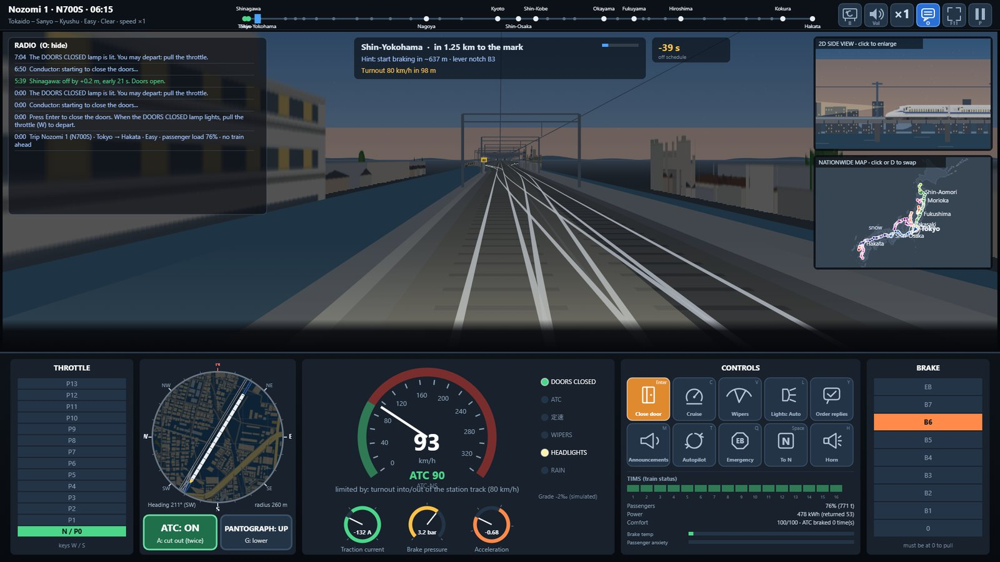
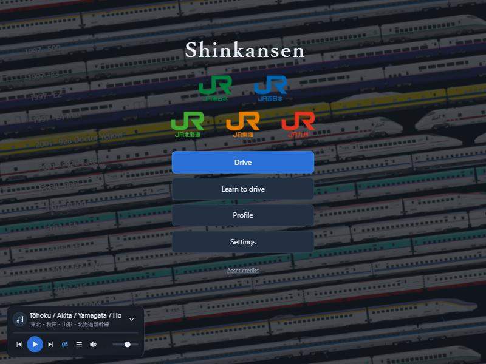
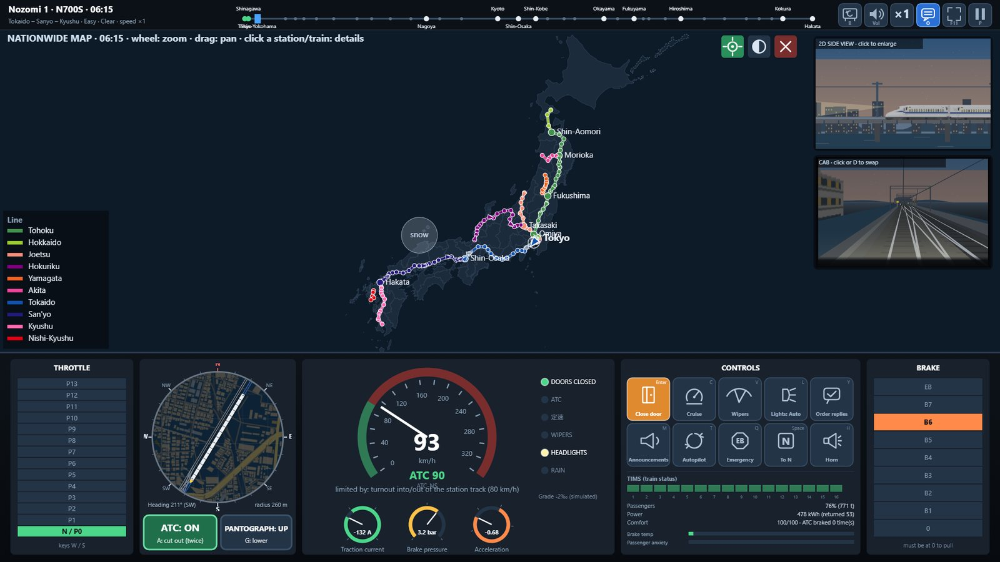
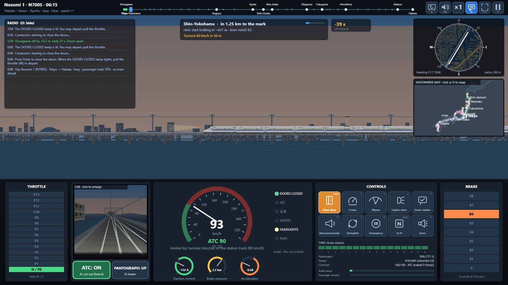
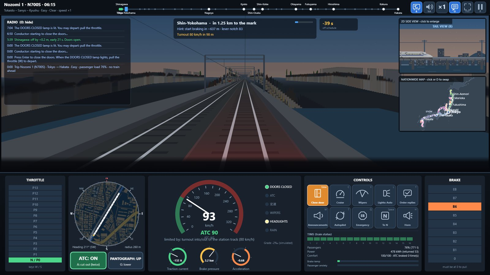
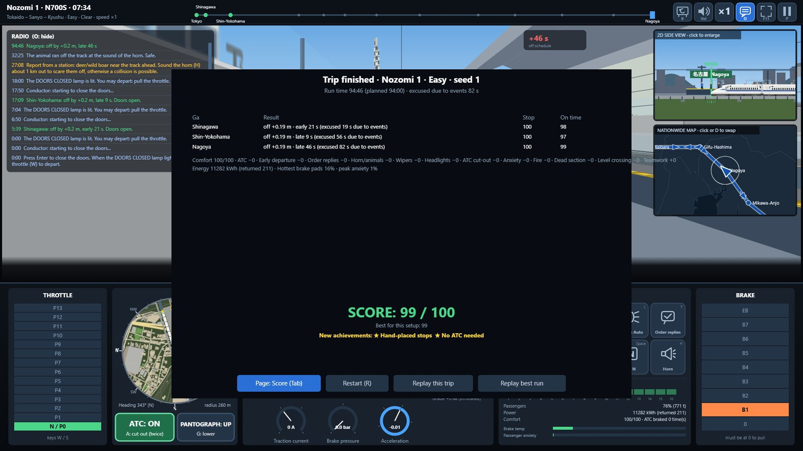

<div align="center">

# Lái Shinkansen · Drive Shinkansen · 新幹線を運転

**Tiếng Việt** · [English](README.en.md) · [日本語](README.ja.md)

Game lái tàu Shinkansen của 5 công ty JR, chạy hoàn toàn trong trình duyệt (HTML/JS, không cần cài gì).



</div>

Dự án sở thích, **không chính thức và không liên quan tới JR hay bất kỳ công ty nào được nhắc tên**. Tên, mẫu tàu, tên ga là tên gọi thật chỉ nhằm mô phỏng.

**Chơi:** trang GitHub Pages của kho này (xem tab *Settings → Pages*), hoặc chạy ở máy (xem mục *Chạy ở máy*). Giao diện có 3 ngôn ngữ: **English, 日本語, Tiếng Việt** (chọn ở Cài đặt; mặc định theo ngôn ngữ trình duyệt).

## Có gì
- **7 tuyến, 5 công ty JR:** Tokaido–Sanyo–Kyushu, Tohoku–Hokkaido, Joetsu, Hokuriku, Nishi-Kyushu và hai tuyến Mini-Shinkansen Yamagata, Akita (kể cả đoàn ghép/tách tại Tokyo, Fukushima, Morioka). **Lịch tàu thật tháng 10/2026**, đủ mẫu tàu từ N700/N700S, E5, E6, E7/W7, E8, H5, 800, N700S-8000 tới tàu kiểm tra 923 Doctor Yellow, E926 East i.
- **Lái thật:** 13 nấc kéo, 8 nấc phanh, ATC, tốc độ không đổi, cần vẹt, gạt mưa, đèn pha, đoạn cách điện đổi tần số, đường tránh và đường thông qua ở ga, ghi ra/vào sân ga, tàu chạy trước và tàu thông qua theo lịch thật.
- **Thời tiết và sự cố ngẫu nhiên (theo seed):** mưa, tuyết, bão, động đất, cháy trong hầm, hành khách bệnh, động vật, xe kẹt ở đường ngang, lệnh điều độ phải nhắc lại, dừng nhường tàu nhanh. 4 độ khó.
- **Nhiều góc nhìn:** buồng lái 3D giả, nhìn ngang 2D, bản đồ nhỏ nhìn từ trên (bắc ở trên), cửa sổ hành khách trái/phải, camera cuối đoàn.
- **Bản đồ toàn quốc** ([ảnh](#ảnh-chụp)): 47 tỉnh với **mọi đảo có trong dữ liệu** (kể cả các đảo Lãnh thổ phương Bắc vẽ nét đứt), 10 đoạn tuyến theo màu Wikipedia, **mọi tàu chạy theo lịch thật** cùng thời tiết và động đất; bấm ga hoặc tàu để xem chi tiết, kể cả tàu phía trước/sau và khoảng cách.
- **Phát thanh trên tàu bằng giọng tiếng Nhật**, kèm phụ đề (giao diện tiếng Nhật chỉ có một dòng phụ đề), báo ga kế tiếp, tuyến đổi tàu, cửa mở bên nào, trễ giờ, sự cố.
- **Học lái:** 4 bài từng bước (lái và dừng ga, thiết bị, sự cố, cần vẹt và ATC). **Hồ sơ:** 14 thành tích, kết quả tốt nhất, lịch sử, xem lại chuyến đã chơi.
- **Âm thanh:** tiếng chạy, gió, mưa, còi, tiếng nền ga; ù cabin máy bay (J); **trình phát nhạc** ở menu với 21 giai điệu ga Shinkansen.
- **Đa ngôn ngữ:** English, 日本語 (tên ga bằng chữ Hán, tên chuyến dạng のぞみ1号), Tiếng Việt.
- Cảnh vật dựng từ dữ liệu OpenStreetMap; tài liệu nghiệp vụ ở [`docs/`](docs/00-progress.md), thiết kế ở [`docs/10-thiet-ke-game.md`](docs/10-thiet-ke-game.md).

## Ảnh chụp
| | |
|---|---|
| <br>Màn hình chủ, trình phát nhạc ở góc dưới trái | <br>Bản đồ toàn quốc: mọi tàu theo lịch thật |
| <br>Góc nhìn ngang 2D | <br>Camera cuối đoàn |
| <br>Tổng kết chuyến: điểm, thành tích, lời khuyên | |

## Menu
- **Màn hình chủ:** Lái tàu · Học lái · Hồ sơ · Cài đặt · Ghi công tài nguyên (và logo 5 công ty JR, bấm vào mở trang chính thức).
- **Thiết lập chuyến đi:** hình đầu đoàn 2D của tàu đang chọn; tuyến, chiều, tàu, ga đi/đến, độ khó, thời tiết, seed, ghép tàu nhánh; cùng một seed cho cùng một chuyến.
- **Chế độ thực tế** (ô đánh dấu đầu cột bên phải): lấy **giờ Nhật Bản** (chỉ còn các chuyến chưa rời ga; hết chuyến thì chỉ còn tàu kiểm tra Doctor Yellow, East i), **thời tiết thật** (mưa, tuyết, gió giật theo giờ dọc tuyến, từ Open-Meteo) và **động đất thật** (P2PQuake: vài giờ qua thì chạy kiểm tra chậm quanh tâm chấn; trận xảy ra **trong lúc đang chơi** thì cắt điện nếu rung đủ mạnh tại tàu). Độ khó cố định Thường. Cần mạng khi bấm Bắt đầu và (cho động đất) trong lúc chơi; mất mạng thì dùng thời tiết ngẫu nhiên. Dữ liệu được chụp lại lúc bắt đầu và các trận động đất mới được ghi như thao tác, nên xem lại chuyến vẫn đúng.
- **Tạm dừng (P hoặc Esc):** Tiếp tục · Cài đặt · Hồ sơ · Chụp cảnh (F9) · Chơi lại · Về menu chính.
- **Cài đặt:** ngôn ngữ, cảnh vật (đầy đủ/nhẹ) và **bảng phím tắt đầy đủ**. Khi có điện đàm, tua tự về ×1.
- **Trình phát nhạc** (góc dưới trái, chỉ ở menu): phát/tạm dừng, bài trước/sau, đổi chế độ lặp danh sách/lặp một bài/ngẫu nhiên, danh sách bài, tắt tiếng và âm lượng, thanh tiến trình, thu gọn; phát qua trình nhúng YouTube (cần mạng), tự phát từ lần bấm đầu tiên.

## Điều khiển nhanh
Bảng đầy đủ nằm trong **Cài đặt → Phím tắt**.

| Phím | Việc |
|---|---|
| W / S | tăng / giảm cần gia tốc (13 nấc) |
| ↓ / ↑ | tăng / giảm cần phanh (nhả về 0 mới kéo lại) |
| Space · Q | về N · phanh khẩn |
| Enter | đóng cửa, đèn sáng thì kéo cần để đi |
| C · [ ] | tốc độ không đổi · chỉnh ∓5 km/h |
| A · G · V · L | ATC (bấm 2 lần để cắt) · cần vẹt · gạt mưa · đèn pha |
| Y / N · M | nhắc lại lệnh, chấp nhận / từ chối · phát thanh trấn an |
| X · K | (tàu kiểm tra) bật đo · đánh dấu lỗi |
| Tab · B · O | đổi khung nhìn · camera cuối đoàn · ẩn điện đàm |
| , · . | cửa sổ hành khách bên trái · bên phải (bấm lại để về buồng lái) |
| J | bật/tắt ù cabin máy bay (nút loa góc trên phải: bấm 1 lần xổ thanh âm lượng, bấm lần 2 tắt tiếng) |
| D | hoán đổi nhanh giữa bản đồ toàn quốc và góc nhìn đang dùng (con lăn zoom, kéo di chuyển, bấm ga/tàu xem chi tiết; nút định vị về tàu ta) |
| H | còi (game cũng tự bấm còi ở khu làm việc, hươu, ga không dừng, đường ngang, tàu đứng phía trước) |
| P (hoặc Esc) · F9 · F11 | tạm dừng · chụp cảnh (ảnh PNG + tệp JSON dựng lại cảnh) · toàn màn hình |
| 1 2 3 · T · R | tua ×1/×4/×16 (nút vuông ×N góc trên phải đổi vòng ×1 → ×4 → ×16) · tự lái · chạy lại |

## Chạy ở máy
```
cd prototype/drive
python -m http.server            # rồi mở http://localhost:8000
```
Mở thẳng `index.html` cũng chạy, nhưng âm thanh nền ga không tua được và trình phát nhạc cần địa chỉ `http://`.

## Kiểm thử và triển khai
```
node tests/run.js                # kiểm thử mô phỏng, bản đồ, đa ngôn ngữ... (~5 phút)
node tests/run.js --time         # in thời gian từng phần
node tests/run.js --shard=1/4    # chỉ chạy lô 1 trong 4 (chia để chạy song song)
```
GitHub Actions: `ci.yml` chạy kiểm thử mỗi lần đẩy mã; `pages.yml` chạy kiểm thử rồi đưa thư mục `prototype/drive` lên GitHub Pages. Ghi chú kỹ thuật (tệp, đa ngôn ngữ, bản đồ, nhạc) ở [`prototype/README.md`](prototype/README.md).

## Ghi công và giấy phép tài nguyên
| Thành phần | Tác giả / nguồn | Giấy phép |
|---|---|---|
| Biểu tượng tab trang (`prototype/drive/assets/logo.png`) | 西日本旅客鉄道 (JR West), [File:Shinkansen-W.png](https://commons.wikimedia.org/wiki/File:Shinkansen-W.png), Wikimedia Commons | CC BY-SA 4.0 |
| Logo JR Hokkaido / East / Central / West / Kyushu ở màn hình chủ (`jr_*.png`) | Các công ty JR tương ứng | Nhãn hiệu của từng công ty; chỉ minh hoạ, bấm vào mở trang chính thức |
| Hình tàu 2D (N700, N700S, E5, E6, E7/W7, E8, H5, 800, N700S-8000, 923, E926, E2, 500, E3, E4) và hình mặt trước cắt từ các hình đó | Nanyue Express / K.Y. Chung — [rail.kychung.com](https://rail.kychung.com/) | CC BY-NC-ND 4.0. Dải toa trong `prototype/drive/assets/*_strip.*` và ảnh xem trước `pv_*.png` là bản cắt ghép từ hình gốc; **chỉ dùng phi thương mại**, chủ sở hữu hình có quyền yêu cầu gỡ. Xem `prototype/drive/assets/NGUON.md`. |
| Bản đồ, nhà, đường, công viên, cây; đường bờ các đảo Lãnh thổ phương Bắc | © OpenStreetMap contributors — [openstreetmap.org/copyright](https://www.openstreetmap.org/copyright), dữ liệu tải từ [Geofabrik](https://download.geofabrik.de/) và Overpass API | ODbL 1.0. Dữ liệu biên dịch trong `prototype/drive/world/` và `japanmap_nt.js` là cơ sở dữ liệu phái sinh, cũng theo ODbL. |
| Ranh giới 47 tỉnh (bản đồ toàn quốc, `japanmap.js`) | [geoBoundaries](https://www.geoboundaries.org) gbOpen JPN ADM1 (2017) | ODbL 1.0 |
| Tiếng nền ga và tàu qua ga | Flavien Gillié, "Odawara Station, Préfecture de Kanagawa, Japon – Shinkansen train leaving for Tokyo", Internet Archive `aporee_70029_81567` | Public Domain Mark 1.0 |
| Giai điệu ga Shinkansen (trình phát nhạc) | Video YouTube [`bddFo2Vzi4A`](https://www.youtube.com/watch?v=bddFo2Vzi4A), phát qua trình nhúng chính thức, không lưu tệp | Thuộc chủ sở hữu video và JR; theo điều khoản YouTube |
| Bố trí đường và sân ga từng ga | Wikipedia tiếng Nhật (các bài về từng ga) | CC BY-SA 4.0 |
| Thời tiết thật (chế độ thực tế) | [Open-Meteo.com](https://open-meteo.com/), dự báo theo giờ; gọi từ trình duyệt khi bấm Bắt đầu, không lưu lại ngoài snapshot của chuyến | CC BY 4.0 (dữ liệu), dùng phi thương mại |
| Động đất thật (chế độ thực tế) | [P2P地震情報](https://www.p2pquake.net/) (dữ liệu Cục Khí tượng Nhật Bản, JMA); gọi từ trình duyệt khi bấm Bắt đầu | Theo điều khoản của P2P地震情報 và JMA |
| Lịch tàu thật tháng 10/2026 (`docs/data/`, `data-lines.js`) | JR East (lịch tàu số), JR West / JRおでかけネット (một ngày thật) | Dữ liệu thuộc về JR East, JR West và Kotsu Shimbunsha; đọc từ trang công khai (robots.txt cho phép). Dùng làm dữ liệu mô phỏng, không chính thức. |
| Số liệu kỹ thuật, quy trình, sự cố | Danh mục nguồn ở cuối từng tệp trong `docs/` (JR Central, JTSB, trafficnews, Wikipedia…) | Chỉ trích dẫn, không chép nguyên văn |

Nếu bạn là chủ sở hữu một tài nguyên ở trên và muốn gỡ hoặc ghi công khác, hãy mở issue; tài nguyên sẽ được gỡ. Ảnh chụp trong `docs/screenshots/` chứa hình tàu CC BY-NC-ND và dữ liệu OSM nói trên.

## Giấy phép
**Mã nguồn** (các tệp `.js`, `.html`, `.py` do tác giả viết) theo [MIT](LICENSE), © 2026 Tachibana11111.

Giấy phép MIT **không áp dụng** cho: hình tàu và dải toa (CC BY-NC-ND 4.0, K.Y. Chung), dữ liệu OpenStreetMap và geoBoundaries đã biên dịch (ODbL), logo, âm thanh và nhạc, lịch tàu, tài liệu nghiệp vụ và ảnh chụp; mỗi thứ giữ giấy phép hoặc điều kiện riêng ghi ở bảng trên. Tên "Shinkansen", "JR" và tên các mẫu tàu thuộc chủ sở hữu tương ứng; giấy phép này không cấp quyền dùng chúng.
